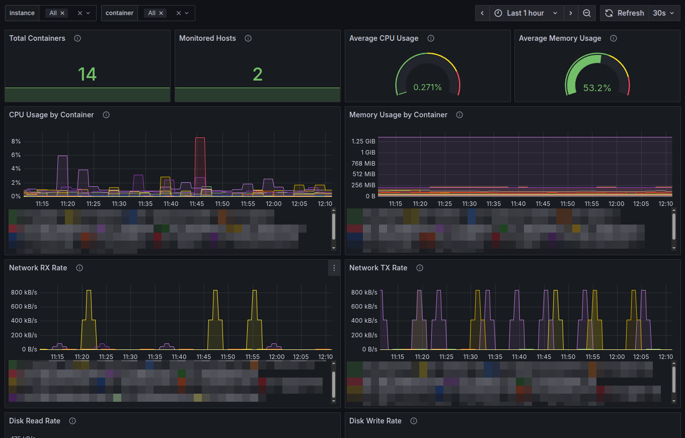

# Prometheus Docker Stats Exporter

A lightweight Prometheus exporter for Docker container statistics. The supported way to run the exporter is as a Docker container; it connects to the host Docker daemon through its Docker socket and exposes metrics over HTTP.

## Features

- Collects CPU, memory, network I/O, block I/O, and PID statistics using `docker stats`
- Exposes metrics in Prometheus format
- Supports configurable collection interval, port, log level, bind address, and instance name
- Includes an example Prometheus configuration and a multi-host Grafana dashboard

## Requirements

- Docker Engine on the host being monitored
- Access to the host Docker socket at `/var/run/docker.sock`

The exporter container needs access to the Docker daemon socket to collect statistics. Access to this socket is highly privileged and can grant control over the host; only run a trusted exporter image and protect access to the metrics endpoint according to your environment.

## Published image

Tagged releases are built by GitHub Actions and published to the GitHub Container Registry for `linux/amd64` and `linux/arm64`:

```bash
docker pull ghcr.io/itefix/prometheus-dockerstats-exporter:latest
```

Pushing a tag such as `1.2.3` (or `v1.2.3`) publishes `1.2.3`, `1.2`, `1` and `latest`. A weekly workflow removes untagged images older than 30 days. In the examples below, replace `prometheus-dockerstats-exporter:local` with the published image name if you do not build locally.

## Build and run

Build the image from the repository:

```bash
docker build -t prometheus-dockerstats-exporter:local .
```

Start the exporter on the Docker host:

```bash
docker run -d \
  --name docker-stats-exporter \
  --restart unless-stopped \
  -p 9417:9417 \
  -v /var/run/docker.sock:/var/run/docker.sock \
  prometheus-dockerstats-exporter:local
```

Check the exporter and metrics endpoint:

```bash
docker logs docker-stats-exporter
curl http://localhost:9417/metrics
```

The container listens on port `9417`; publish it on a different host port if needed, for example `-p 9418:9417`. To configure the listener inside the container, pass the corresponding exporter option after the image name:

```bash
docker run -d \
  --name docker-stats-exporter \
  --restart unless-stopped \
  -p 9418:9418 \
  -v /var/run/docker.sock:/var/run/docker.sock \
  prometheus-dockerstats-exporter:local \
  --port 9418 --interval 30 --log-level INFO --instance-name docker-host-1
```

Available options:

| Option | Default | Description |
|--------|---------|-------------|
| `--port PORT` | `9417` | Port to expose metrics on |
| `--interval SECONDS` | `15` | Collection interval |
| `--log-level LEVEL` | `INFO` | Log level: `DEBUG`, `INFO`, `WARN`, or `ERROR` |
| `--bind-address ADDR` | `0.0.0.0` | Address to bind the HTTP server to inside the container |
| `--instance-name NAME` | Container hostname | Instance name used in metric labels |
| `--config FILE` | `/opt/docker-stats-exporter/docker-stats-exporter.conf` | Configuration file path |
| `--help` | — | Show usage |

The image includes a default configuration file. To use a customized one, mount it into the container and pass its path with `--config`:

```bash
docker run -d \
  --name docker-stats-exporter \
  --restart unless-stopped \
  -p 9417:9417 \
  -v /var/run/docker.sock:/var/run/docker.sock \
  -v "$PWD/docker-stats-exporter.conf:/etc/docker-stats-exporter.conf:ro" \
  prometheus-dockerstats-exporter:local \
  --config /etc/docker-stats-exporter.conf
```

## Metrics

| Metric | Description |
|--------|-------------|
| `docker_container_cpu_usage_percent` | Container CPU usage percentage |
| `docker_container_memory_usage_bytes` | Container memory usage in bytes |
| `docker_container_memory_limit_bytes` | Container memory limit in bytes |
| `docker_container_memory_usage_percent` | Container memory usage percentage |
| `docker_container_network_rx_bytes_total` | Total network bytes received |
| `docker_container_network_tx_bytes_total` | Total network bytes transmitted |
| `docker_container_block_io_read_bytes_total` | Total block I/O bytes read |
| `docker_container_block_io_write_bytes_total` | Total block I/O bytes written |
| `docker_container_pids` | Number of PIDs in the container |
| `docker_stats_exporter_up` | Exporter status (`1`=up, `0`=down) |
| `docker_stats_exporter_last_scrape_timestamp_seconds` | Timestamp of the latest successful scrape |

Container metrics include `instance`, `container_id`, and `container_name` labels. Exporter metrics include the `instance` label.

## Prometheus configuration

Configure Prometheus to scrape the exporter at the host and published port:

```yaml
scrape_configs:
  - job_name: docker-stats-exporter
    static_configs:
      - targets: ["localhost:9417"]
        labels:
          instance: docker-host-1
    scrape_interval: 15s
    metrics_path: /metrics
```

For a remote host, replace `localhost` with the Docker host's reachable address. The `instance` label can distinguish exporters when monitoring multiple hosts. A complete example is available in [prometheus-config-example.yml](prometheus-config-example.yml).

## Grafana dashboard

Import [grafana-dashboard.json](grafana-dashboard.json) into Grafana and select your Prometheus datasource. The dashboard includes multi-host and container filters, overview statistics, CPU and memory charts, network and disk I/O, and top-container tables.

## Troubleshooting

- **Exporter cannot connect to Docker:** Verify that Docker is running and that the host socket exists at `/var/run/docker.sock`. Check container logs with `docker logs docker-stats-exporter`.
- **Socket permission denied:** Ensure the container process can access the Docker socket. Socket permissions vary by host configuration.
- **No metrics at the endpoint:** Confirm the container is running, the port is published (`docker port docker-stats-exporter`), and the endpoint is reachable at `http://localhost:9417/metrics`.
- **Port conflict:** Choose an unused host port in the `-p HOST_PORT:CONTAINER_PORT` mapping. If changing the container port too, pass the same port with `--port`.

## Development

Build the image locally with `docker build -t prometheus-dockerstats-exporter:local .` and run it using the instructions above. The exporter is intended to run inside the image rather than directly on the host.

## Versioning and releases

The project follows [Semantic Versioning](https://semver.org/) and keeps a [CHANGELOG](CHANGELOG.md). To release:

1. Move the `Unreleased` entries in `CHANGELOG.md` under a new `## [X.Y.Z] - YYYY-MM-DD` heading and update the compare links at the bottom.
2. Commit and push to `main`.
3. Tag and push: `git tag X.Y.Z && git push origin X.Y.Z`.

The tag push triggers [build-image.yml](.github/workflows/build-image.yml). [cleanup-images.yml](.github/workflows/cleanup-images.yml) runs weekly and can be started manually with an optional dry run.

## License

This project is licensed under the BSD 2-Clause License; see [LICENSE](LICENSE).
